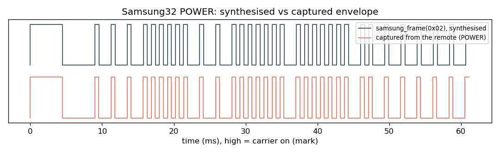
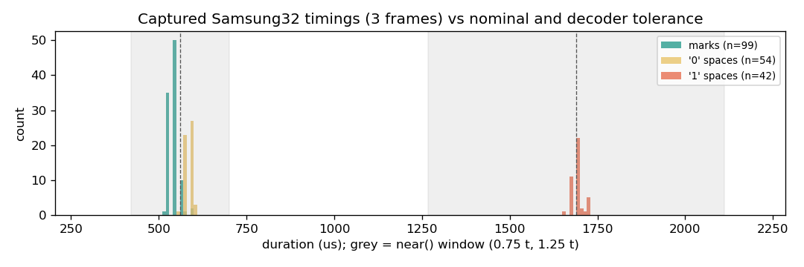

# ir-parrot



Zephyr firmware for a nice!nano (nRF52840) that captures IR remote frames with a 38 kHz receiver module, decodes NEC, Samsung32 and Sony SIRC, and sends them back through an IR LED with a hardware-PWM carrier. Point a remote at it and the frame is printed on the USB console as a ready-to-paste `TX` command; `REPLAY` sends it again. Edges are timestamped with the Cortex-M4 cycle counter at 15.6 ns resolution.

## Hardware

| Part | Connection |
|---|---|
| nice!nano v2 or clone (nRF52840), Adafruit nRF52 UF2 bootloader, no SoftDevice | USB to the host |
| IR receiver, VS1838B / TSOP style (GND, VCC, OUT) | VCC from P0.17 (driven high by firmware), OUT on P0.20 |
| IR transmitter module (DAT, VCC, GND), LED driven directly by DAT | DAT on P0.31, VCC from the board's switched VCC (P0.13 control) |

The blue LED on P0.15 comes on when the firmware is running.

`boards/arm/nice_nano/` replaces the upstream board because the clone this was built on is not a genuine nice!nano. Its bootloader reports `SoftDevice: not found` and jumps to the application at `0x1000`, right after the MBR. There is no 32.768 kHz crystal, so LFCLK runs from the calibrated internal RC, and DCDC defaults to off because the inductors may be missing.

| Partition | Start | Size |
|---|---|---|
| MBR | `0x00000` | 4 KB |
| application | `0x01000` | 940 KB |
| storage (unused) | `0xEC000` | 32 KB |
| UF2 bootloader | `0xF4000` | 48 KB |

## Build and flash

Tested with nRF Connect SDK v2.6.0 (Zephyr 3.5.99). The board uses the pre-HWMv2 layout and the app uses the legacy USB device stack, so newer SDKs need porting.

```sh
west build -b nice_nano -p always    # CMakeLists.txt adds the local BOARD_ROOT
```

Double-tap reset to get the bootloader's USB drive and copy `build/zephyr/zephyr.uf2` onto it. Once the firmware is running, `DFU` on the console writes `0x57` to `GPREGRET` (the Adafruit UF2 magic) and reboots into the bootloader. Any serial terminal works; CDC ACM ignores the baud rate:

```sh
screen <SERIAL_PORT> 115200
```

| Command | Action |
|---|---|
| *(press a remote)* | prints the decoded protocol and a `TX 38 ...` line |
| `REPLAY [khz]` | send the last captured frame (default 38 kHz) |
| `TX khz d0 d1 ...` | send mark/space durations in µs (even count, 20-60 kHz) |
| `SAMSUNG cmd [n]` | synthesise a Samsung32 frame for address `0x07`, send it `n` times |
| `LOOP cmd` / `LOOPBB cmd` | send a Samsung32 frame while sampling the board's own receiver; `LOOPBB` uses a bit-banged carrier with interrupts locked |
| `SCAN [s]` / `TXSCAN [cmd]` | count transitions on every free pin, idle or while transmitting |
| `PROBE`, `STAT`, `REGS`, `DUMP` | receiver presence, pin states, PWM registers, raw edge intervals |
| `BLINK`, `SLOWBLINK [n]`, `PINTEST [n]` | LED tests (a phone camera sees IR) |
| `INV 0/1`, `EXTVCC 0/1`, `PWR29 0/1` | invert carrier polarity, switch VCC, power a module from P0.29 |
| `CRASH` | reset reason and last fault (PC, LR, thread) |
| `DFU` | reboot into the UF2 bootloader |

[`codes/samsung_tv.txt`](codes/samsung_tv.txt) has three frames from a Samsung TV remote, each sendable as a `TX` line. Most of the diagnostic commands exist because bringing up a no-name clone without a debugger needed them.

## Transmit

A frame is a list of durations $d_0, d_1, \dots, d_{2n-1}$ in µs, marks at even indices. The carrier runs at 1/3 duty, common in remotes because it gives the LED a better peak-to-average current ratio than 1/2:

$$T_c = \frac{10^9}{f_c}\ \text{ns}, \qquad t_\text{on} = \left\lfloor \frac{T_c}{3} \right\rfloor$$

At 38 kHz that is $T_c = 26315$ ns and $t_\text{on} = 8771$ ns. The envelope comes from rewriting PWM0's duty at each segment boundary and busy-waiting $d_i$ µs.

Samsung32 sends $v = A \;|\; (A \ll 8) \;|\; (C \ll 16) \;|\; (\lnot C \ll 24)$ LSB first after a 4500/4500 µs header. A bit is a 560 µs mark followed by a 1690 µs space for 1 or 560 µs for 0, then a 560 µs stop mark and a 46 ms gap. $C$ and $\lnot C$ always hold eight 1-bits between them, so the frame length depends only on the address:

$$T_\text{frame} = 2 \cdot 4500 + 32 \cdot 560 + n_1 \cdot 1690 + (32 - n_1) \cdot 560 + 560, \quad n_1 = 2\,\text{popcount}(A) + 8$$

For $A = \texttt{0x07}$, $n_1 = 14$ and every command lasts 61.22 ms before the gap.

## Receive and decode

The receiver output idles high and goes low during a mark. A falling-edge interrupt records `DWT->CYCCNT` and wakes a top-priority cooperative thread, which busy-polls the port and timestamps every edge ($\Delta t = \Delta\text{cycles}/64\ \text{MHz}$). Per-edge interrupts can't keep up with sensors that pass the raw carrier, hence the polling. A frame closes after 20 ms without an edge (an NEC repeat arrives about 40 ms later), capped at 300 ms and 4096 edges. Interrupts stay on so USB keeps working, and the thread sleeps 10 ms before re-arming so a noisy line can't starve the console. Two buffers alternate between capture and decode.

If the shortest interval is under 150 µs the sensor is passing the carrier through, and edges closer than 300 µs are merged into one mark. An odd-length result gets a closing 20 ms space so transmit always sees mark/space pairs.

Every timing check uses one ±25 % window in integer arithmetic, $\tfrac{3t}{4} < v < \tfrac{5t}{4}$:

| Protocol | Leader | Bits |
|---|---|---|
| NEC | 9000 / 4500 µs (repeat: 9000 / 2250) | 32, pulse distance, 560 / 1690 / 560 |
| Samsung32 | 4500 / 4500 µs | 32, pulse distance, 560 / 1690 / 560 |
| Sony SIRC | 2400 / 600 µs | 12, 15 or 20, pulse width: 1200 µs mark = 1, 600 µs = 0 |

Anything else is reported as unknown with its leader timings and can still be replayed verbatim. The three captured frames decode as address `0x0707`, commands `0x02`, `0x07`, `0x0B`. Against nominal timings ([`docs/make_figures.py`](docs/make_figures.py)):

| Segment | n | Mean | Nominal | Mean error | Range |
|---|---|---|---|---|---|
| header | 6 | 4501.2 µs | 4500 | +0.0 % | -0.4 to +0.4 % |
| bit mark | 99 | 540.7 µs | 560 | -3.4 % | -7.3 to +5.9 % |
| '0' space | 54 | 587.1 µs | 560 | +4.8 % | -1.2 to +7.1 % |
| '1' space | 42 | 1692.5 µs | 1690 | +0.1 % | -2.4 to +1.9 % |

Marks come out about 20 µs short and the following spaces about 20 µs long, with mark + space close to nominal, which fits a receiver that reacts a little later to the start of a burst than to its end. The worst error, 7.3 %, is well inside the window.



All console output goes through `printk` on the main thread with logging disabled; the CDC ACM transmit ring buffer is not safe with concurrent producers, and that race crashed the board during development. With no debugger attached, a custom `k_sys_fatal_error_handler` stores reason, PC, LR and thread name in `__noinit` RAM and soft-resets, and `CRASH` reports it with `RESETREAS` on the next boot.

## Limitations

- Only the last frame is kept, in RAM. Nothing is saved to flash.
- A demodulating receiver hides the carrier frequency, so `REPLAY` defaults to 38 kHz.
- Durations are 16-bit (max 65.5 ms each), at most 512 per frame.
- Transmit timing is software-paced (`k_busy_wait`); jitter not measured.
- The LED hangs off a high-drive GPIO with no transistor, so range is short.
- BLE (Nordic UART Service) is in the code but compiled out (`CONFIG_BT=n`).
- Tested on one clone board with NCS v2.6.0 only.

## License

MIT, see [LICENSE](LICENSE).
