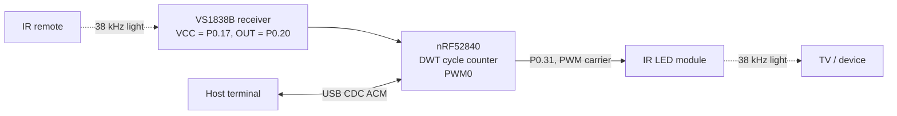

# irtransmitter: learn and replay IR remote codes on a nice!nano

Zephyr firmware for a nice!nano (nRF52840) that captures infrared remote-control frames with a
cheap 38 kHz receiver module, decodes NEC, Samsung32 and Sony SIRC, and transmits them back through
an IR LED with a hardware-PWM carrier. Everything is driven from a USB serial console: point a remote
at the receiver, the frame is printed as a ready-to-paste `TX` command, and `REPLAY` sends it again.

It also carries the bench tools that were needed to bring it up on a no-name clone board: a
transmit-to-own-receiver loopback test, a bit-banged carrier, pin activity scanners, register
dumps and a crash log that survives reset.

## Hardware

| Part | Connection |
|---|---|
| nice!nano v2 or clone (nRF52840) with the Adafruit nRF52 UF2 bootloader, **no SoftDevice** | USB to the host |
| IR receiver module, VS1838B / TSOP style (GND, VCC, OUT) | VCC from **P0.17** (driven high by firmware), OUT on **P0.20** |
| IR transmitter module (DAT, VCC, GND), LED driven directly by DAT | DAT on **P0.31**, VCC from the board's switched VCC (P0.13 control) |

The blue LED on P0.15 is turned on when the firmware is running.



### Why a custom board definition

`boards/arm/nice_nano/` replaces the upstream one because the clone this was built on differs from a
genuine nice!nano:

- The UF2 bootloader reports `SoftDevice: not found`, so it jumps to the application at `0x1000`
  (right after the MBR), not at the usual SoftDevice offset. The flash map is:

  | Partition | Start | Size |
  |---|---|---|
  | MBR | `0x00000` | 4 KB |
  | application | `0x01000` | 940 KB |
  | storage (unused) | `0xEC000` | 32 KB |
  | UF2 bootloader | `0xF4000` | 48 KB |

- No 32.768 kHz crystal is fitted, so LFCLK runs from the calibrated internal RC oscillator.
- The DC/DC inductors may be missing, so DCDC mode defaults to off.

## Build and flash

Tested with **nRF Connect SDK v2.6.0** (Zephyr 3.5.99). The board definition uses the pre-HWMv2
layout and the app uses the legacy USB device stack, so newer SDKs need porting.

```sh
west build -b nice_nano -p always          # from the repo root; CMakeLists.txt adds the local BOARD_ROOT
```

Flash `build/zephyr/zephyr.uf2`: double-tap reset to get the bootloader's USB drive and copy the file
onto it. Once this firmware is running, sending `DFU` on the console reboots straight into the
bootloader (it writes `0x57` to `GPREGRET`, the Adafruit bootloader's UF2 magic).

Open the console with any serial terminal (CDC ACM ignores the baud rate):

```sh
screen <SERIAL_PORT> 115200
```

## Console commands

| Command | Action |
|---|---|
| *(press a remote)* | captured frame is printed with its decoded protocol and as a `TX 38 ...` line |
| `REPLAY [khz]` | send the last captured frame (default 38 kHz) |
| `TX khz d0 d1 ...` | send arbitrary mark/space durations in µs (even count, 20-60 kHz) |
| `SAMSUNG cmd [n]` | synthesise and send a Samsung32 frame for address `0x07`, `n` times |
| `LOOP cmd` | send a Samsung32 frame while sampling the board's own receiver, print what came back |
| `LOOPBB cmd` | same, with a CPU bit-banged carrier and interrupts locked (isolates the PWM) |
| `SCAN [s]` / `TXSCAN [cmd]` | count transitions on every free pin, idle or while transmitting |
| `PROBE`, `STAT`, `REGS`, `DUMP` | receiver presence, pin states, PWM registers, raw edge intervals |
| `BLINK`, `SLOWBLINK [n]`, `PINTEST [n]` | visible LED tests (a phone camera sees IR) |
| `INV 0/1`, `EXTVCC 0/1`, `PWR29 0/1` | invert carrier polarity, switch VCC, power a module from P0.29 |
| `CRASH` | reset reason and last fault (PC, LR, thread) |
| `DFU` | reboot into the UF2 bootloader |

[`codes/samsung_tv.txt`](codes/samsung_tv.txt) holds three frames captured from a Samsung TV remote,
each directly sendable as a `TX` line.

## How it works

### Transmit: carrier and envelope

A frame is a list of durations $d_0, d_1, \dots, d_{2n-1}$ in µs; even indices are marks (carrier on),
odd ones spaces. For carrier frequency $f_c$ the PWM period and on-time are

$$T_c = \frac{10^9}{f_c}\ \text{ns}, \qquad t_\text{on} = \left\lfloor \frac{T_c}{3} \right\rfloor$$

so at 38 kHz, $T_c = 26315$ ns and $t_\text{on} = 8771$ ns. A 1/3 duty cycle, common in IR remotes,
gives the LED a better peak-to-average current ratio than 1/2. The envelope is produced by reprogramming
PWM0's duty (on-time or zero) at each segment boundary and busy-waiting $d_i$ µs.

### Samsung32 encoding

The 32-bit word, sent LSB first, is

$$v = A \;|\; (A \ll 8) \;|\; (C \ll 16) \;|\; (\lnot C \ll 24)$$

after a 4500 µs mark / 4500 µs space header. Each bit is a 560 µs mark followed by a 1690 µs space
for 1 or a 560 µs space for 0 (pulse-distance coding), then a 560 µs stop mark and a 46 ms gap.
Since $C$ and $\lnot C$ together always contain exactly eight 1-bits, the frame length depends only on
the address:

$$T_\text{frame} = 2 \cdot 4500 + 32 \cdot 560 + n_1 \cdot 1690 + (32 - n_1) \cdot 560 + 560, \quad n_1 = 2\,\text{popcount}(A) + 8$$

For $A = \texttt{0x07}$, $n_1 = 14$ and every command lasts 61.22 ms before the gap.


### Receive: capture

The receiver's OUT pin idles high and goes low during a mark. A falling-edge GPIO interrupt records
the Cortex-M4 cycle counter `DWT->CYCCNT` and wakes a cooperative thread at the highest priority,
which then busy-polls the port register and timestamps every edge:

$$\Delta t = \frac{\Delta\text{cycles}}{64\ \text{MHz}}, \qquad \text{resolution} = 15.6\ \text{ns}$$

The frame closes after 20 ms without an edge (an NEC repeat arrives about 40 ms later), with a hard
cap of 300 ms and 4096 edges. Interrupts stay enabled, so USB keeps working; the thread sleeps 10 ms
before re-arming so a noisy line cannot starve the console. Polling instead of one interrupt per edge
is deliberate: per-edge interrupts cannot keep up with sensors that output the raw carrier.

Two buffers alternate: the thread fills one while the main loop decodes the other.

### Receive: demodulated vs raw sensors

If the shortest edge-to-edge interval is under 150 µs the sensor is passing the carrier through, so
the firmware demodulates in software: consecutive edges closer than 300 µs are merged into one mark.
Otherwise every interval is already a mark or a space. An odd-length result is closed with a 20 ms
space so that transmit always gets mark/space pairs.

### Decoding and tolerance

Every timing comparison uses one window of ±25 %, implemented in integer arithmetic:

$$\text{near}(v, t) \iff \tfrac{3t}{4} < v < \tfrac{5t}{4}$$

| Protocol | Leader | Bits |
|---|---|---|
| NEC | 9000 / 4500 µs (repeat: 9000 / 2250) | 32, pulse distance, 560 / 1690 / 560 |
| Samsung32 | 4500 / 4500 µs | 32, pulse distance, 560 / 1690 / 560 |
| Sony SIRC | 2400 / 600 µs | 12, 15 or 20, pulse width: 1200 µs mark = 1, 600 µs = 0 |

Anything else is reported as unknown with its leader timings, and can still be replayed verbatim.

The three captured frames all decode (address `0x0707`, commands `0x02`, `0x07`, `0x0B`). Measured
against the nominal timings by [`docs/make_figures.py`](docs/make_figures.py):

| Segment | n | Mean | Nominal | Mean error | Range |
|---|---|---|---|---|---|
| header | 6 | 4501.2 µs | 4500 | +0.0 % | -0.4 to +0.4 % |
| bit mark | 99 | 540.7 µs | 560 | -3.4 % | -7.3 to +5.9 % |
| '0' space | 54 | 587.1 µs | 560 | +4.8 % | -1.2 to +7.1 % |
| '1' space | 42 | 1692.5 µs | 1690 | +0.1 % | -2.4 to +1.9 % |

Marks come out about 20 µs short and the following spaces about 20 µs long, while mark + space stays
close to nominal. That is consistent with a demodulating receiver whose output reacts slightly later to
the start of a burst than to its end. The worst error, 7.3 %, leaves a wide margin inside the ±25 %
window.


### Robustness

- **Single writer on the console.** All output goes through `printk` on the main thread and the
  logging subsystem is disabled: the CDC ACM transmit ring buffer is not safe with several concurrent
  producers, and that race crashed the board during development.
- **Crash black box.** A custom `k_sys_fatal_error_handler` stores reason, PC, LR and thread name in
  `__noinit` RAM and soft-resets; `CRASH` reports it together with `RESETREAS` on the next boot.
  This replaces a debugger, since none is attached to this board.

## Limitations

- Only the last captured frame is kept, in RAM. The storage partition exists but nothing is saved to flash.
- A demodulating receiver hides the carrier frequency, so `REPLAY` uses 38 kHz unless told otherwise.
- Durations are 16-bit (max 65.5 ms each) and a frame holds at most 512 durations.
- Transmit timing is software-paced (`k_busy_wait` between PWM updates); its jitter has not been measured.
- The LED is driven straight from a high-drive GPIO with no transistor, so range is short.
- BLE (Nordic UART Service) support is in the code but compiled out (`CONFIG_BT=n`).
- Built and tested on a single clone board with NCS v2.6.0 only.

## License

MIT, see [LICENSE](LICENSE).
